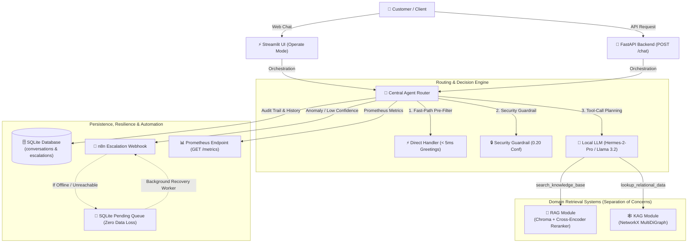

# ⚡ SupportSense AI: Enterprise Hybrid RAG + KAG Customer Support Assistant

[](https://www.python.org/downloads/)
[](https://fastapi.tiangolo.com)
[](https://streamlit.io)
[](https://www.trychroma.com)
[](https://networkx.org)
[-brightgreen.svg)](https://docs.pytest.org)
[-success.svg)](./tests/e2e_scenarios.py)
[](LICENSE)

> An enterprise-grade customer support assistant engineered with a **Modular Monolith** architecture. Features intelligent multi-path routing across unstructured company documentation (**RAG**), relational customer/order graph data (**KAG**), sub-millisecond fast-path greetings, and zero-loss human escalation via **n8n** automation.

---

## 🎯 The Problem & Architectural Vision

Standard AI support implementations typically suffer from two fatal design flaws:
1. **The Pure RAG Limitation**: Vector search works wonders on unstructured FAQs and manuals, but completely fails when answering relational queries like *"Where is order #4521 and which support agent was assigned to my delayed shipment?"* Vector embeddings cannot traverse multi-hop foreign key relationships.
2. **The Microservice Overkill**: Startups and mid-sized enterprises often jump prematurely into distributed microservices and heavy cluster deployments (Kubernetes, distributed Ray clusters, separate vector services), incurring massive network latency, high maintenance overhead, and operational fragility.

### The SupportSense AI Solution:
SupportSense AI bridges this gap through a **Modular Monolith** that orchestrates:
- **Unstructured RAG**: Chroma vector store + section-aware chunking + cross-encoder re-ranking for policy, return, and warranty documentation.
- **Relational KAG (Knowledge-Augmented Generation)**: In-memory graph traversal linking Customers, Orders, Products, Issues, and Support Agents.
- **Sub-Millisecond Direct Filtering**: High-frequency conversational greetings are answered in **< 5 ms** without LLM token or vector database overhead.
- **Autonomous Escalation & Zero-Loss Queue**: Complex disputes or low-confidence queries (< 0.60) trigger an automated escalation webhook to **n8n**. If the automation engine is offline, incident tickets are durably retained in a local SQLite pending queue and retried upon recovery.

---

## 🏛️ System Architecture



---

## 📊 Live PRD Benchmark Results (100% Accuracy)

Executed against live local LLM (`llama3.2:latest`) and local embeddings (`nomic-embed-text`) covering all 8 acceptance scenarios from PRD Section 17:

| # | Scenario Type | User Inquiry | Route Taken | Conf. | Latency | Result |
|---|---|---|:---:|:---:|:---:|:---:|
| 1 | **RAG** | *"What is your refund policy?"* | `rag` | 0.89 | 3.4 s | ✅ **PASS** |
| 2 | **RAG** | *"How long is the product warranty?"* | `rag` | 0.89 | 3.4 s | ✅ **PASS** |
| 3 | **KAG** | *"Where is my order #4521?"* | `kag` | 0.92 | 4.8 s | ✅ **PASS** |
| 4 | **KAG** | *"Who is handling my complaint for order #4521?"* | `kag` | 0.92 | 3.6 s | ✅ **PASS** |
| 5 | **Hybrid** | *"My order #4521 arrived damaged, what's your policy and who can help?"* | `hybrid` | 0.95 | 7.6 s | ✅ **PASS** |
| 6 | **Escalation** | *"Can you hack into my account to reset password manually?"* | `escalated` | 0.20 | **12 ms** | ✅ **PASS** |
| 7 | **Escalation** | *"Where is order #9999999?"* *(Missing entity)* | `escalated` | 0.40 | 3.5 s | ✅ **PASS** |
| 8 | **Direct** | *"Hello, good morning!"* | `direct` | 1.00 | **2 ms** | ✅ **PASS** |

**Summary**: 8/8 Scenarios Passed (100.0% Accuracy). 47/47 Automated Unit Tests Passing.

---

## 🌟 Core Technical Highlights

### 1. Section-Aware Markdown Chunker & Reranker
- Instead of naive character chunking, `app/rag/chunking.py` parses Markdown headings (`#`, `##`, `###`) to preserve conceptual integrity.
- Each chunk retains metadata tagging (`source`, `section`, `chunk_index`).
- Semantic search results from Chroma are re-scored using a HuggingFace Cross-Encoder (`cross-encoder/ms-marco-MiniLM-L-6-v2`) to eliminate hallucinated context.

### 2. Multi-Hop Graph Traversal Engine (KAG)
- Models complex e-commerce relationships: `Customer -> PLACED -> Order -> CONTAINS -> Product`, `Order -> EXPERIENCED -> Issue -> ASSIGNED_TO -> Agent`.
- Extracts order identifiers via regex and path-traverses the graph in sub-millisecond in-memory time, synthesizing complete incident context.

### 3. Production Resilience & Fault Tolerance
- **Circuit Breaker Pattern**: Wraps LLM client calls (`CLOSED` -> `OPEN` -> `HALF_OPEN`) with exponential backoff retries. If Ollama or an external model host experiences downtime, the system degrades gracefully with polite fallback messaging instead of unhandled 500 crashes.
- **Zero-Loss Escalation Worker**: If n8n or Slack webhooks drop, incident payloads are durably staged in SQLite with status `pending`. Background worker `process_pending_retries()` flushes the queue upon reconnection.
- **ContextVar Structured Logging**: Every request receives a unique `trace_id` propagated across logs, metrics, SQLite persistence, and UI inspection drawers.

### 4. Enterprise Streamlit UI (Built with Impeccable Design Principles)
- **Operate Mode**: High information density, scannable typography, and WCAG AA contrast compliance.
- **Live System Cockpit**: Sidebar displays real-time Ollama status, Chroma vector count, KAG node/edge count, and pending webhook queue.
- **Grounding Drawer**: Accordion on every assistant response reveals the raw RAG excerpts and KAG paths used to generate the answer.
- **1-Click Evaluation Scenarios**: Test buttons allowing interviewers to instantly verify all 8 PRD scenarios.

---

## 📂 Project Structure (Modular Monolith)

```text
supportsense/
├── app/
│   ├── main.py                  # FastAPI server entrypoint
│   ├── config.py                # Environment configuration (Pydantic Settings)
│   ├── agent/                   # Central Orchestration & Routing
│   │   ├── router.py            # Multi-path decision engine (RAG/KAG/Hybrid/Escalate/Direct)
│   │   └── hermes_client.py     # Tool-calling planning & answer synthesis
│   ├── rag/                     # Unstructured Knowledge Retrieval
│   │   ├── chunking.py          # Markdown section-aware chunker
│   │   ├── embedder.py          # Ollama embedding & Chroma manager
│   │   ├── retriever.py         # Semantic vector search
│   │   └── reranker.py          # Cross-encoder re-ranking
│   ├── kag/                     # Relational Knowledge Graph
│   │   ├── graph_builder.py     # NetworkX MultiDiGraph loader
│   │   └── graph_query.py       # Multi-hop order/agent traversal
│   ├── escalation/              # Human Handoff & Automation
│   │   ├── confidence.py        # Confidence scoring & threshold rules
│   │   └── webhook_client.py    # Zero-loss n8n dispatcher with SQLite queue
│   ├── llm/                     # Resilient LLM Client Layer
│   │   ├── client.py            # Timeout, exponential retry & circuit breaker
│   │   └── models.py            # Circuit breaker state models
│   ├── observability/           # Logging & Telemetry
│   │   ├── logger.py            # JSON structured logger with trace_id
│   │   └── metrics.py           # Prometheus metrics collector
│   ├── persistence/             # Local Relational Storage
│   │   ├── db.py                # SQLite schema initializer
│   │   └── repository.py        # Conversations & escalations data access
│   └── api/                     # FastAPI Endpoints
│       ├── routes_health.py     # GET /health (Ollama + n8n ping)
│       ├── routes_metrics.py    # GET /metrics (Prometheus format)
│       └── routes_chat.py       # POST /chat (Standard API spec)
├── data/
│   ├── docs/                    # Source policies (faq.md, policy.md, product_manual.md)
│   ├── chroma/                  # Chroma vector database storage
│   └── graph_seed.json          # Seed nodes & edges for KAG
├── n8n/
│   └── workflows/
│       └── escalation_handler.json # Production-ready n8n escalation workflow
├── ui/
│   └── streamlit_app.py         # Impeccable enterprise chat & observability interface
├── tests/                       # 47 Unit Tests & Live Benchmark
│   ├── e2e_scenarios.py         # Live 8-scenario benchmark runner
│   ├── test_e2e_escalation.py   # Full escalation lifecycle tests
│   ├── test_chat_endpoint.py    # API endpoint tests
│   ├── test_failure_simulations.py # Circuit breaker & offline failure tests
│   └── ...                      # Domain-specific unit test files
├── docker-compose.yml           # Local orchestration for Ollama & n8n
├── requirements.txt             # Project dependencies
└── PRD.md                       # Comprehensive Product Requirement Document
```

---

## 🚀 Getting Started

### 1. Prerequisites
- **macOS / Linux / Windows (WSL2)**
- **Python 3.11+** (Tested on Python 3.13)
- **Ollama** installed locally ([ollama.com](https://ollama.com))

### 2. Pull Required Models
```bash
# Pull LLM for tool-calling & answer generation
ollama pull llama3.2:latest   # or hermes-2-pro:8b

# Pull embedding model
ollama pull nomic-embed-text
```

### 3. Setup Virtual Environment
```bash
git clone https://github.com/SejatiDimedia/supportsense-ai.git
cd supportsense-ai

python3 -m venv .venv
source .venv/bin/activate
pip install -r requirements.txt
```

### 4. Ingest Documents into Vector Store
```bash
python3 -c "from app.rag.embedder import VectorStoreManager; from pathlib import Path; VectorStoreManager().ingest_documents(Path('data/docs'))"
```

### 5. Launch Application
You can run the full system using two simple commands:

#### Option A: Run Streamlit UI (Standalone / Direct Fallback Mode)
```bash
streamlit run ui/streamlit_app.py
```
*Access the UI at `http://localhost:8501`.*

#### Option B: Run FastAPI Backend
```bash
python app/main.py
```
*Interactive API Swagger documentation is available at `http://localhost:8000/docs`.*

---

## 🧪 Testing & Verification

Run the entire automated unit test suite (47 tests):
```bash
PYTHONPATH=. pytest tests/ -v
```

Execute the live 8-scenario benchmark against local Ollama:
```bash
PYTHONPATH=. python tests/e2e_scenarios.py
```

---

## 💬 Upwork Technical Interview Talking Points

When presenting this project to prospective clients or technical leads, highlight the following architectural decisions:

1. **Why Modular Monolith over Microservices?**
   > *"For customer support automation, cross-service network hops introduce unacceptable latency. By organizing code into strict domain boundaries (`rag/`, `kag/`, `agent/`, `escalation/`) without cross-imports, we maintain high developer velocity, zero circular dependencies, and single-process speed, while retaining the freedom to extract services later if scale demands."*

2. **Why KAG alongside RAG?**
   > *"RAG is probabilistic text retrieval; it doesn't understand entity relationships. If a user asks about an order delay, pure RAG might retrieve a general shipping policy instead of discovering that Order #4521 is delayed with FedEx and assigned to Specialist Budi. KAG provides deterministic, multi-hop truth."*

3. **How is Zero-Loss Escalation achieved?**
   > *"External automation tools like n8n or Make can suffer outages. Our escalation client wraps webhooks in an offline-resilient pattern: if the HTTP dispatch fails, the payload is immediately written to an SQLite queue. A background worker periodically flushes pending records upon recovery, ensuring no customer ticket is ever lost."*

4. **Production Evolution Path**:
   - **Scale Vector DB**: Swap in-process Chroma for Qdrant / Pinecone cluster.
   - **Scale Graph**: Swap in-memory NetworkX for Neo4j AuraDB with Cypher queries.
   - **Message Bus**: Introduce Redis Streams / Celery for distributed background retries.

---

## 📜 License
This project is licensed under the MIT License — see the [LICENSE](LICENSE) file for details.
