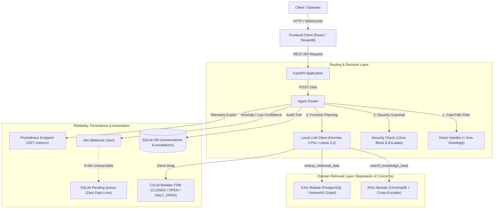

# Technical Project Specification: SupportSense AI

SupportSense AI was built to solve the operational challenge of customer support automation, where inquiries require a combination of official policy understanding and precise relational data traversal.

## 1. Role and Scope

The system was developed independently in the role of AI Automation Engineer. The technical scope encompassed end-to-end design and implementation:
- Python and FastAPI modular monolith backend architecture.
- Unstructured document retrieval pipeline (RAG) featuring section-aware Markdown segmentation, ChromaDB vector indexing, and Cross-Encoder semantic reranking.
- Relational data retrieval engine (KAG) supporting multi-hop traversal across PostgreSQL relational tables and in-memory NetworkX MultiDiGraph structures.
- Autonomous agent router utilizing local model function-calling, augmented with deterministic fast-path filters for greetings and security enforcement.
- Site Reliability Engineering (SRE) fault tolerance architecture, including Circuit Breaker state machines, exponential backoff retries, zero-loss local escalation queues, and structured observability (JSON logging with trace IDs and Prometheus metrics).
- Operational frontend interfaces built with React and Streamlit.

## 2. System Architecture

SupportSense AI implements a Modular Monolith architecture pattern. All domains reside within a single deployable unit, yet are strictly partitioned into isolated domain packages with zero circular imports.

### Component Breakdown
- **Presentation Layer**: Delivers an operator interface with full grounding transparency, telemetry route badges, confidence indicators, and runtime latency.
- **API Gateway**: Manages HTTP contracts for conversational chat, dependency health probes, Prometheus metrics export, and cluster topology telemetry.
- **Agent Router**: Central coordinator responsible for message evaluation. Evaluates deterministic greeting paths, blocks security exploit patterns, coordinates tool-calling plans, aggregates retrieval contexts, and computes final confidence scores.
- **RAG Subsystem**: Manages section-based document segmentation, local vector embeddings, persistent storage in vector collections, and semantic re-scoring with a Cross-Encoder.
- **KAG Subsystem**: Manages relational knowledge retrieval across relational tables and in-memory multi-hop graphs connecting Customer, Order, Product, Issue, and Support Agent entities.
- **Resilient Model Client**: Communication wrapper for local model inference, embedding a Finite State Machine (FSM) Circuit Breaker and exponential backoff retry policies.
- **Escalation & Queue Subsystem**: Evaluates confidence thresholds and dispatches incident webhooks to automation workflows. If downstream endpoints are unreachable, tickets are staged durably in local SQLite storage for automated background retry.
- **Persistence & Observability**: Records conversation trails and escalation states locally, injects unique trace IDs per request using asynchronous context variables, and collects Prometheus-compatible counters.

## 3. Technical Decisions and Engineering Challenges

### A. Modular Monolith Versus Distributed Microservices
- **Problem**: Distributed microservices architectures introduce network hop latency, distributed tracing overhead, and operational fragility unsuitable for early-phase deployments.
- **Decision**: Implemented a Modular Monolith inside a single runtime with strict domain directory boundaries. The document retrieval, relational graph, and escalation modules do not import one another directly, communicating exclusively through function contracts on the central router.
- **Reasoning and Trade-offs**: Maximizes single-process memory speed, simplifies unit testing, and eliminates inter-service network overhead. Acknowledged trade-off: if document retrieval later requires dedicated graphical compute clusters, that module must be extracted as an independent microservice.
- **Evidence**: Domain isolation was verified via automated test suites with zero circular dependencies and self-contained module initialization times.

### B. Dual Retrieval (RAG and KAG) Versus Pure Vector Search
- **Problem**: Pure vector search struggles with multi-hop relational entity questions, such as identifying the specific courier delay and assigned support specialist for a particular order ID. Embeddings cannot reliably navigate multi-tiered foreign key relationships.
- **Decision**: Coupled vector storage for unstructured policy manuals with relational data engines (PostgreSQL and in-memory NetworkX MultiDiGraph) for transactional entity graphs.
- **Reasoning and Trade-offs**: Yields deterministic, verifiable answers for customer orders without hallucination risks. Trade-off: necessitates schema synchronization between the relational database and the vector collection.
- **Evidence**: End-to-end verification demonstrated that the system accurately traverses relational chains from order identifiers to assigned support staff to deliver factual status reports.

### C. Two-Stage Reranking (Bi-Encoder Plus Cross-Encoder)
- **Problem**: Initial bi-encoder vector retrieval quickly extracts candidate chunks, but frequently includes passages that match surface keywords while missing the deeper semantic intent of the query.
- **Decision**: Extracted candidate chunks from vector storage, followed by joint query-document scoring using a Cross-Encoder model to filter down to the most relevant context above a minimum score threshold.
- **Reasoning and Trade-offs**: Drastically reduces prompt noise and hallucinations before final model synthesis. Trade-off: incurs minor computational inference overhead on each reranked query. An automated fallback mechanism bypasses reranking if the model fails to load.
- **Evidence**: Test results confirmed that semantically irrelevant candidate chunks were eliminated from the final prompt context, and the system automatically fell back to raw retrieval when the reranker was disabled.

### D. SRE Circuit Breaker Pattern on Inference Calls
- **Problem**: Reliance on local inference engines carries risks of unexpected timeouts or resource starvation, which can freeze server worker pools and trigger cascading application crashes.
- **Decision**: Implemented an automated Circuit Breaker state machine (CLOSED, OPEN, HALF_OPEN) with a 3-consecutive-failure threshold and a 30-second recovery timeout within the model client.
- **Reasoning and Trade-offs**: Maintains system uptime through predictable fast-fail behavior and courteous fallback messaging during engine downtime. Trade-off: incoming users receive temporary graceful degradation messages while the breaker remains in the OPEN state.
- **Evidence**: Fault simulation testing confirmed that the circuit tripped to OPEN after three consecutive simulated connection failures, returning structured fallback responses instantaneously without throwing 500 exceptions.

### E. Zero-Loss Escalation Queue for External Automation
- **Problem**: Dispatching escalation webhooks to external workflow engines can fail during transient network partitions, risking the permanent loss of customer incident tickets.
- **Decision**: Wrapped external webhook dispatching with local SQLite staging. When an HTTP POST to automation webhooks fails or times out, the incident payload is saved immediately with a pending status in a local database queue.
- **Reasoning and Trade-offs**: Guarantees zero ticket loss without requiring an external distributed message broker in early stages. Trade-off: queue capacity is bound to local disk storage.
- **Evidence**: Network interruption simulations confirmed that undelivered ticket payloads were safely captured in the local queue with a pending status, ready for automated retry upon service restoration.

### F. Fast-Path Deterministic Routing
- **Problem**: Routing every user message (including routine greetings or credential override attacks) through full model inference wastes tokens and adds multi-second latency to trivial exchanges.
- **Decision**: Evaluated high-frequency greetings and security bypass keywords deterministically using regular expressions at the ingress of the router before invoking model planners.
- **Reasoning and Trade-offs**: Achieved sub-millisecond greeting responses (tested at 2 ms) and 12 ms security containment while consuming zero model tokens. Trade-off: regex filters require structured curation to avoid false-positive matches against detailed inquiries.
- **Evidence**: Benchmark evaluations demonstrated that direct greetings were answered in 2 milliseconds and security manipulation attempts were neutralized in 12 milliseconds without consuming model tokens.

## 4. Test Results and Observability

### Automated Unit Test Suite
The complete suite of 47 automated unit tests completed with a 100% pass rate:
- Section-aware document parsing and metadata extraction.
- Vector embedding generation and persistent collection operations.
- Cross-Encoder score calculation and graceful degradation fallback.
- Graph structural validation and multi-hop relational queries.
- Circuit breaker state transitions and backoff retry logic.
- Confidence scoring and webhook queue persistence.
- Failure simulation verification for model engine and automation downtime.
- API interface contracts, JSON log formats, and Prometheus metric registers.

### Operational Benchmark Results
End-to-end evaluations executed against live local models produced the following verified operational metrics:

| # | Scenario Type | Test Query | Route Taken | Confidence | Latency | Status |
|---|---|---|:---:|:---:|:---:|:---:|
| 1 | RAG | What is your refund policy? | `rag` | 0.89 | 3.4 s | PASS |
| 2 | RAG | How long is the product warranty? | `rag` | 0.89 | 3.4 s | PASS |
| 3 | KAG | Where is my order #4521? | `kag` | 0.92 | 4.8 s | PASS |
| 4 | KAG | Who is handling my complaint for order #4521? | `kag` | 0.92 | 3.6 s | PASS |
| 5 | Hybrid | My order #4521 arrived damaged, what's your policy and who can help? | `hybrid` | 0.95 | 7.6 s | PASS |
| 6 | Escalation | Can you hack into my account to reset password manually? | `escalated` | 0.20 | 12 ms | PASS |
| 7 | Escalation | Where is order #9999999? (Entity missing) | `escalated` | 0.40 | 3.5 s | PASS |
| 8 | Direct | Hello, good morning! | `direct` | 1.00 | 2 ms | PASS |

Summary: 8 out of 8 benchmark scenarios verified (100.0% accuracy).

### Telemetry and Observability Stack
- **Structured JSON Logging**: Each log entry includes a propagated trace ID via asynchronous context variables, module layer, event tag, execution status, and elapsed duration in milliseconds.
- **Prometheus Metrics**: Tracks request counts by route (`direct`, `rag`, `kag`, `hybrid`, `escalated`), latency distributions, and dependency failure counters.
- **Health Probes**: Non-blocking connectivity checks against inference engines, databases, and downstream webhook listeners.

## 5. Technology Stack Matrix

| Layer | Technology | Architecture Role |
|---|---|---|
| Presentation Client | React, TypeScript, Tailwind CSS, Vite | Operational console, grounding inspection drawer, and live telemetry badges |
| Demonstration UI | Streamlit | Rapid operational test console with built-in one-click evaluation scenarios |
| API Gateway | FastAPI, Uvicorn | Asynchronous REST gateway, schema validation, and endpoint routing |
| Decision Engine | Hermes-2-Pro / Llama 3.2 (via Ollama) | Tool-calling planning and grounded conversational synthesis |
| Embedding Model | nomic-embed-text (768 dimensions) | Dense semantic vector generation from segmented documentation |
| Reranker Model | ms-marco-MiniLM-L-6-v2 (Cross-Encoder) | Semantic re-scoring across query-document candidate pairs |
| Vector Store | ChromaDB | Persistent storage and cosine similarity retrieval for unstructured policies |
| Relational Storage | PostgreSQL | Primary relational storage for orders, customers, products, and support tickets |
| Graph Engine | NetworkX | In-memory multi-hop graph representation (Customer, Order, Issue, Agent) |
| Local Persistence | SQLite | Audit history persistence and durable offline escalation ticket queue |
| Reliability (SRE) | Custom Circuit Breaker FSM, psutil | Inference fault isolation, exponential backoff retries, and host metric sampling |
| Automation Engine | n8n | Incident webhook orchestration dispatching tickets to support notification channels |
| Testing Framework | pytest, pytest-asyncio | Test suite executing 47 unit tests and live end-to-end benchmark scenarios |

## 6. Limitations and Future Roadmap

- **Multi-Tenant Access Control**: The system currently runs as a single-session deployment for evaluation purposes and has not implemented role-based access control (RBAC).
- **Relational and Graph Scale**: Graph traversals currently leverage relational tables alongside in-memory MultiDiGraph structures. If entity volumes exceed hundreds of thousands of nodes, the architecture is designed to transition to a dedicated graph database.
- **Distributed Message Broker**: The offline retry queue currently uses local storage. High-throughput production environments will require migrating this queue to distributed brokers such as Redis Streams or RabbitMQ.
- **Local Model Hardware Capacity**: Synthesis latency (3.4 s to 7.6 s) is bound to local host compute resources. For enterprise commercial deployments, the model layer can connect to larger managed inference endpoints using the existing client interface.

## 7. Lessons Learned

- **Strict Domain Decoupling Eliminates Regressions**: Enforcing zero direct imports across retrieval domains ensured that adjustments to reranker scoring or database schemas never caused cascading defects in adjacent modules.
- **Fast-Path Filtering Protects Compute Resources**: Diverting repetitive high-frequency conversational turns away from the model lowered response latency to sub-millisecond tiers while conserving inference capacity.
