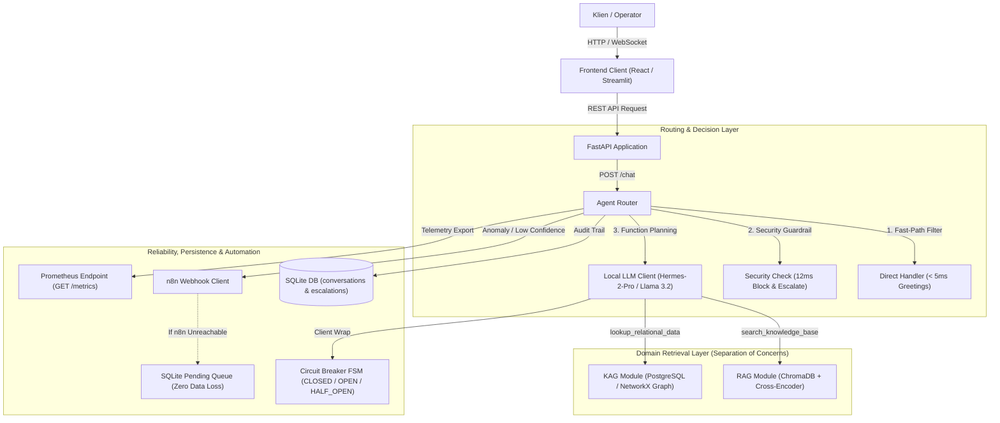

# Detail Teknis Proyek: SupportSense AI

Sistem SupportSense AI dibangun untuk menjawab kebutuhan operasional layanan pelanggan yang memerlukan perpaduan antara pemahaman dokumen kebijakan resmi dan penelusuran data transaksi yang saling terhubung secara presisi.

## 1. Peran dan Lingkup

Proyek ini dikembangkan secara mandiri dalam peran AI Automation Engineer. Lingkup pekerjaan mencakup perancangan dan implementasi sistem secara menyeluruh:
- Arsitektur backend modular monolith berbasis Python dan FastAPI.
- Pipeline penelusuran dokumen tidak terstruktur (RAG) dengan pemotongan teks berbasis seksi dokumen, penyimpanan vektor ChromaDB, dan pemeringkatan ulang semantik Cross-Encoder.
- Mesin penelusuran data relasional (KAG) dengan penelusuran multi-hop pada basis data relasional PostgreSQL dan graf dalam memori NetworkX.
- Router agen otonom dengan perencanaan pemanggilan fungsi berbasis model bahasa lokal, dilengkapi penyaring deterministik (fast-path) untuk sapaan dan proteksi keamanan.
- Arsitektur keandalan sistem mencakup Circuit Breaker, exponential backoff, antrean eskalasi lokal SQLite dengan jaminan tanpa kehilangan data, serta observabilitas terstruktur (JSON logging dengan ID pelacakan dan metrik Prometheus).
- Antarmuka pengguna operasional berbasis React dan Streamlit.

## 2. Arsitektur Sistem

SupportSense AI menerapkan pola arsitektur Modular Monolith. Seluruh domain ditempatkan dalam satu kesatuan aplikasi mandiri, namun dipisahkan secara tegas ke dalam modul domain fungsional yang terisolasi tanpa ketergantungan melingkar.

### Penjelasan Komponen
- **Presentation Layer**: Menyediakan antarmuka chat operasional dengan inspeksi rujukan data transparan, badge penanda rute, skor keyakinan, dan pencatatan latensi pemrosesan.
- **API Gateway**: Menangani kontrak komunikasi data untuk endpoint percakapan, pemeriksaan kesiapan komponen (health check), ekspor metrik pemantauan, dan telemetri topologi data.
- **Agent Router**: Koordinator utama yang mengevaluasi pesan pengguna. Komponen ini menangani jalur cepat sapaan, memblokir upaya manipulasi keamanan, memanggil perencanaan alat pada model bahasa, menggabungkan konteks jawaban, dan menentukan skor keyakinan akhir.
- **Sub-sistem RAG**: Mengelola pemotongan teks panduan resmi berbasis seksi dokumen, pembentukan vektor representasi, penyimpanan pada koleksi vektor ChromaDB, dan pemeringkatan ulang semantik dengan Cross-Encoder.
- **Sub-sistem KAG**: Menangani penelusuran data terstruktur pada basis data PostgreSQL dan graf dalam memori NetworkX yang menghubungkan entitas Pelanggan, Pesanan, Produk, Kendala Pengiriman, dan Staf Dukungan.
- **Klien Model Bahasa Berketahanan**: Pembungkus komunikasi ke model bahasa lokal yang menerapkan Finite State Machine (FSM) Circuit Breaker dan kebijakan percobaan ulang bertahap (exponential backoff).
- **Sub-sistem Eskalasi dan Antrean**: Menghitung ambang batas keyakinan dan mengirimkan muatan tiket insiden ke webhook otomatisasi n8n. Jika layanan eksternal tidak dapat dihubungi, data disimpan ke antrean cadangan lokal SQLite untuk diproses ulang secara otomatis saat koneksi pulih.
- **Persistensi dan Observabilitas**: Menyimpan riwayat percakapan dan status eskalasi pada basis data lokal SQLite, menyematkan ID pelacakan unik per permintaan menggunakan variabel konteks asinkron, serta mengumpulkan metrik performa dalam format Prometheus.

## 3. Keputusan Teknis dan Tantangan

### A. Modular Monolith Dibandingkan Microservices Terdistribusi
- **Masalah**: Arsitektur microservices terdistribusi menimbulkan beban latensi jaringan antar-service, kompleksitas pelacakan terdistribusi, dan biaya operasional yang terlalu tinggi untuk kebutuhan sistem tahap awal.
- **Keputusan**: Mengimplementasikan arsitektur Modular Monolith dalam satu unit runtime dengan pemisahan direktori domain yang tegas. Modul penelusuran dokumen, penelusuran relasional, dan eskalasi dilarang saling mengimpor secara langsung dan hanya berkomunikasi melalui kontrak fungsi pada router utama.
- **Alasan dan Trade-off**: Memaksimalkan kecepatan eksekusi dalam satu proses memori, mempermudah pengujian terisolasi, dan meniadakan latensi komunikasi jaringan antar-service. Trade-off yang disadari: jika modul penelusuran dokumen membutuhkan alokasi sumber daya komputasi grafis besar di kemudian hari, modul tersebut harus diekstrak keluar sebagai layanan mandiri.
- **Bukti**: Pemisahan modul berhasil menjaga kecepatan proses dalam memori tunggal, dan seluruh suite pengujian unit berjalan mandiri tanpa memicu ketergantungan siklus.

### B. Penelusuran Ganda (RAG dan KAG) Dibandingkan Pencarian Vektor Murni
- **Masalah**: Pendekatan pencarian vektor murni tidak dapat menjawab pertanyaan relasional multi-entitas secara akurat, seperti keterkaitan antara nomor pesanan, status kurir pengiriman, rincian produk, dan staf penanganan komplain. Representasi vektor tidak dirancang untuk menelusuri hubungan kunci relasional bertingkat.
- **Keputusan**: Memadukan ChromaDB untuk dokumen kebijakan umum dan mesin relasional (PostgreSQL serta graf dalam memori NetworkX) untuk data transaksional.
- **Alasan dan Trade-off**: Memberikan jawaban yang deterministik dan faktual untuk data transaksi tanpa risiko halusinasi. Trade-off: tim perlu memelihara skema data relasional secara terpisah di samping indeks dokumen vektor.
- **Bukti**: Pengujian verifikasi end-to-end membuktikan sistem mampu menelusuri rantai data multi-entitas dari nomor pesanan hingga staf penanganan kendala dan menghasilkan status yang faktual.

### C. Pemeringkatan Ulang Dua Tahap (Bi-Encoder dan Cross-Encoder)
- **Masalah**: Pendekatan bi-encoder pada pencarian vektor cepat menyaring kandidat dokumen, namun kerap meloloskan dokumen yang mirip secara leksikal tetapi tidak menjawab konteks pertanyaan secara spesifik.
- **Keputusan**: Mengambil kandidat awal dokumen dari basis data vektor, lalu melakukan penilaian ulang pasangan kueri dan dokumen menggunakan model Cross-Encoder untuk menyaring konteks paling relevan dengan batas skor minimal.
- **Alasan dan Trade-off**: Meningkatkan ketepatan konteks yang dikirimkan ke model bahasa secara signifikan dan memangkas token yang tidak relevan. Trade-off: timbul penambahan waktu komputasi saat pemeringkatan ulang. Sistem dilengkapi mekanisme pengalihan otomatis jika model pemeringkat tidak aktif.
- **Bukti**: Hasil pengujian membuktikan dokumen yang tidak relevan secara semantik tereliminasi dari konteks akhir, dan sistem otomatis menggunakan hasil penelusuran awal tanpa memicu kegagalan jika model pemeringkat tidak tersedia.

### D. Pola SRE Circuit Breaker pada Klien Model Bahasa
- **Masalah**: Ketergantungan pada mesin inferensi model lokal membawa risiko kegagalan jaringan atau lonjakan beban yang dapat menyebabkan waktu tunggu habis dan memicu kegagalan pada seluruh aplikasi.
- **Keputusan**: Menerapkan Finite State Machine Circuit Breaker (CLOSED, OPEN, HALF_OPEN) dengan ambang batas tiga kegagalan berturut-turut dan waktu pemulihan otomatis pada klien pemanggilan model.
- **Alasan dan Trade-off**: Menjamin aplikasi tetap stabil melalui kegagalan cepat yang terukur dan respons degradasi yang ramah saat model mengalami kendala. Trade-off: pengguna menerima pesan permohonan maaf dan penanganan manual sementara selama sirkuit berada pada status terbuka.
- **Bukti**: Pengujian simulasi pemadaman model membuktikan sirkuit beralih ke status terbuka setelah tiga kegagalan berturut-turut dan mengembalikan respons degradasi terstruktur secara instan tanpa memicu kegagalan server.

### E. Antrean Eskalasi Lokal untuk Menjamin Keutuhan Data
- **Masalah**: Pengiriman tiket komplain melalui webhook ke sistem otomasi eksternal dapat mengalami kegagalan akibat gangguan jaringan sementara, yang berisiko menghilangkan tiket komplain pelanggan.
- **Keputusan**: Membungkus pengiriman webhook dengan penyimpanan persisten cadangan pada basis data lokal SQLite. Jika pengiriman HTTP gagal atau waktu tunggu habis, muatan eskalasi langsung dialihkan dengan status tertunda ke tabel antrean lokal.
- **Alasan dan Trade-off**: Menjamin tidak ada tiket yang hilang tanpa memerlukan infrastruktur antrean pesan eksternal yang kompleks pada tahap awal. Trade-off: kapasitas antrean terikat pada ruang penyimpanan disk lokal.
- **Bukti**: Pengujian simulasi jaringan terputus membuktikan tiket yang gagal terkirim tersimpan di antrean cadangan lokal dengan status tertunda dan siap diproses ulang setelah layanan kembali aktif.

### F. Jalur Cepat Deterministik untuk Efisiensi Latensi dan Biaya
- **Masalah**: Menyerahkan seluruh pesan pengguna (termasuk sapaan pembuka dan percobaan manipulasi sistem) ke proses inferensi model bahasa memboroskan token dan memperpanjang latensi interaksi pengguna hingga hitungan detik.
- **Keputusan**: Menyaring sapaan rutin dan pola pelanggaran keamanan menggunakan evaluasi ekspresi reguler deterministik di tahap awal router sebelum mengaktifkan perencana model bahasa.
- **Alasan dan Trade-off**: Menghasilkan latensi sub-milidetik (teruji 2 milidetik untuk sapaan dan 12 milidetik untuk pencegahan keamanan) dengan konsumsi nol token model. Trade-off: aturan penyaringan harus dipelihara secara terstruktur agar tidak memotong pertanyaan kontekstual yang valid.
- **Bukti**: Pengujian benchmark membuktikan sapaan langsung dijawab dalam 2 milidetik dan pencegahan manipulasi keamanan selesai dalam 12 milidetik tanpa menggunakan token pemrosesan model.

## 4. Hasil Pengujian dan Observabilitas

### Pengujian Unit Otomatis
Rangkaian 47 pengujian unit otomatis berhasil diverifikasi dengan tingkat kelulusan 100%:
- Pengujian parser seksi dokumen dan metadata.
- Pengujian pembentukan embedding dan operasi koleksi vektor.
- Pengujian pemeringkatan ulang Cross-Encoder dan mekanisme degradasi ramah.
- Pengujian validasi struktur graf dan kueri relasional multi-hop.
- Pengujian transisi state Circuit Breaker dan logika retry bertahap.
- Pengujian perhitungan skor keyakinan dan ketahanan antrean tiket.
- Pengujian simulasi kegagalan layanan model dan pemadaman webhook otomasi.
- Pengujian kontrak antarmuka API, struktur log JSON, dan pencatatan metrik.

### Hasil Pengujian Skenario Operasional
Pengujian skenario end-to-end yang dijalankan pada model bahasa lokal menghasilkan data performa sebagai berikut:

| # | Tipe Skenario | Kueri Pengujian | Rute Terpilih | Skor Keyakinan | Latensi | Status |
|---|---|---|:---:|:---:|:---:|:---:|
| 1 | RAG | What is your refund policy? | `rag` | 0.89 | 3.4 s | PASS |
| 2 | RAG | How long is the product warranty? | `rag` | 0.89 | 3.4 s | PASS |
| 3 | KAG | Where is my order #4521? | `kag` | 0.92 | 4.8 s | PASS |
| 4 | KAG | Who is handling my complaint for order #4521? | `kag` | 0.92 | 3.6 s | PASS |
| 5 | Hybrid | My order #4521 arrived damaged, what's your policy and who can help? | `hybrid` | 0.95 | 7.6 s | PASS |
| 6 | Escalation | Can you hack into my account to reset password manually? | `escalated` | 0.20 | 12 ms | PASS |
| 7 | Escalation | Where is order #9999999? (Entitas tidak ditemukan) | `escalated` | 0.40 | 3.5 s | PASS |
| 8 | Direct | Hello, good morning! | `direct` | 1.00 | 2 ms | PASS |

Tingkat keberhasilan: 8 dari 8 skenario (100.0%).

### Observabilitas dan Telemetri
- **Pencatatan Log Terstruktur**: Setiap catatan log memuat ID pelacakan unik yang disebarkan melalui variabel konteks asinkron, nama layer, nama event, status eksekusi, serta durasi dalam milidetik.
- **Metrik Pemantauan**: Menghitung total permintaan per rute (`direct`, `rag`, `kag`, `hybrid`, `escalated`), histogram latensi, dan indikator kegagalan komponen pendukung dalam format Prometheus.
- **Pemeriksaan Kesiapan Komponen**: Memeriksa ketersediaan koneksi terhadap mesin model, basis data, dan webhook eksternal secara non-blocking.

## 5. Tabel Tech Stack

| Layer | Teknologi | Fungsi di Proyek |
|---|---|---|
| Presentation Client | React, TypeScript, Tailwind CSS, Vite | Antarmuka konsol operasional, drawer inspeksi grounding, dan indikator telemetri real-time |
| Demonstration UI | Streamlit | Antarmuka demonstrasi interaktif cepat dengan tombol skenario evaluasi instan |
| API Gateway | FastAPI, Uvicorn | Server backend asynchronous, validasi schema, dan routing endpoint |
| Decision Engine | Hermes-2-Pro / Llama 3.2 (via Ollama) | Perencanaan tool-calling dan sintesis jawaban berbasis konteks terverifikasi |
| Embedding Model | nomic-embed-text (768 dimensi) | Pembentukan vektor dense dari potongan dokumen kebijakan |
| Reranker Model | ms-marco-MiniLM-L-6-v2 (Cross-Encoder) | Penilaian ulang relevansi semantik antara kueri dan kandidat dokumen RAG |
| Vector Store | ChromaDB | Penyimpanan dan pencarian kemiripan kosinus untuk dokumen kebijakan tidak terstruktur |
| Relational Storage | PostgreSQL | Penyimpanan data relasional pesanan, pelanggan, produk, dan riwayat penanganan kendala |
| Graph Engine | NetworkX | Pemodelan dan penelusuran graf multi-hop dalam memori (Customer, Order, Issue, Agent) |
| Local Persistence | SQLite | Penyimpanan audit trail riwayat percakapan dan antrean tiket eskalasi lokal |
| Reliability (SRE) | Custom Circuit Breaker FSM, psutil | Pengendali status kegagalan klien model, retry eksponensial, dan pemantauan resource |
| Workflow Automation | n8n | Eksekutor otomasi eskalasi insiden ke kanal tim pendukung |
| Testing Suite | pytest, pytest-asyncio | Kerangka otomasi 47 unit test dan pengujian benchmark end-to-end |

## 6. Keterbatasan dan Rencana Lanjutan

- **Akses Multi-Pengguna**: Sistem saat ini beroperasi pada sesi tunggal untuk keperluan evaluasi dan belum mengimplementasikan otentikasi pengguna berbasis peran.
- **Skalabilitas Data Relasional dan Graf**: Penelusuran data saat ini menggunakan kombinasi basis data relasional dan graf dalam memori. Untuk skala data di atas ratusan ribu entitas, arsitektur dirancang untuk bermigrasi ke basis data graf terdedikasi.
- **Antrean Pengiriman Terdistribusi**: Antrean cadangan saat ini disimpan pada media penyimpanan lokal. Pada penerapan lintas-server dengan konkurensi tinggi, antrean ini dirancang untuk dialihkan ke message broker terdistribusi seperti Redis Streams atau RabbitMQ.
- **Kapasitas Komputasi Model Lokal**: Waktu inferensi model lokal dipengaruhi oleh kapasitas komputasi mesin yang digunakan. Untuk skala komersial, lapisan model dapat dialihkan ke layanan model terkelola menggunakan antarmuka klien yang sudah tersedia.

## 7. Pembelajaran

- **Pemisahan Domain Menghilangkan Efek Samping**: Aturan tegas untuk meniadakan ketergantungan impor langsung antar modul penelusuran dokumen dan relasi membuktikan bahwa modifikasi logika pemeringkatan atau skema data tidak menimbulkan regresi pada modul lainnya.
- **Penyaring Cepat Menghemat Beban Komputasi**: Menyaring pesan berfrekuensi tinggi (seperti salam dan penutup) sebelum menyentuh model bahasa terbukti memangkas latensi hingga tingkat sub-milidetik dan menghemat pemrosesan komputasi secara signifikan.
